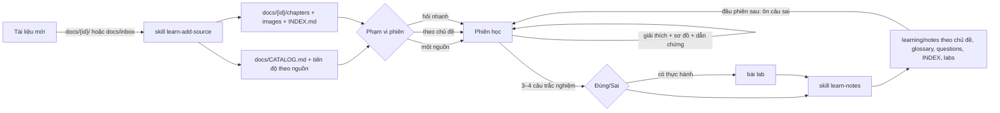

# Learning workspace — {{TOPIC}}

Workspace để học từ sách và tài liệu cùng AI agent (Codex, Claude Code, …).
Agent đọc tài liệu, giải thích có dẫn chứng và sơ đồ, kiểm tra bằng trắc nghiệm,
hướng dẫn thực hành (nếu chủ đề có), rồi lưu kiến thức trọng tâm lại để ôn.

File này dành cho **người**. Agent đọc `AGENTS.md` và các `SKILL.md`.

Workspace này được dựng bởi skill `learn-new-workspace`. Ba skill học (`learn-new-workspace`,
`learn-add-source`, `learn-notes`) được cài **global** trên máy, không nằm trong thư mục này.
Bản gốc của skill và của khung workspace nằm trong repo template (xem README của repo đó).

---

## 0. Bắt đầu

Sau khi dựng, chỉ cần chỉnh 2 chỗ cho chủ đề (skill thường đã hỏi và điền sẵn):
1. `AGENTS.md` mục **0. Cấu hình chủ đề**: có thực hành không, thuật ngữ giữ tiếng Anh,
   phép so sánh, loại sơ đồ. Để trống cũng được, phiên đầu agent sẽ đề xuất.
2. `learning/INDEX.md` mục **Mục tiêu**.

| Agent | Đọc luật từ | Đọc skill từ |
|---|---|---|
| Codex | `AGENTS.md` | `~/.agents/skills/` (global) |
| Claude Code | `CLAUDE.md` (chỉ chứa `@AGENTS.md`) | `~/.claude/skills/` (global) |

Mỗi **chủ đề lớn** một workspace (`network/`, `datacenter/`, `k8s/`…); mỗi **cuốn sách**
là một nguồn `docs/<id>/` trong workspace đó. Không tạo workspace riêng cho từng cuốn: các
sách cùng chủ đề trùng kiến thức nhiều, để chung mới đối chiếu được.

## 1. Cấu trúc

```
<chủ-đề>/
├── AGENTS.md                      # luật cho agent: phạm vi phiên, dẫn chứng, cách dạy, quiz, lab
├── CLAUDE.md                      # "@AGENTS.md" cho Claude Code
├── README.md                      # file này
├── docs/
│   ├── CATALOG.md                 # bản đồ nguồn + chủ đề → nguồn → chương (agent đọc đầu tiên)
│   ├── inbox/                     # (tùy chọn) chỗ bỏ tài liệu mới
│   └── <id>/                      # mỗi nguồn (sách) một thư mục, tên thư mục = id
│       ├── <file gốc>.pdf         # bản gốc
│       ├── INDEX.md               # mục lục chi tiết, hình quan trọng, ghi chú chất lượng
│       ├── chapters/              # 01-xxx.md, 02-xxx.md, _manifest.json
│       └── images/                # p0045-01.png = hình 1 ở trang PDF 45
├── learning/
│   ├── INDEX.md                   # mục tiêu, tiến độ theo nguồn, bản đồ chủ đề, nhật ký phiên
│   ├── glossary.md                # thuật ngữ
│   ├── questions.md               # câu hỏi ôn tập (spaced repetition đơn giản)
│   └── notes/<chủ-đề>.md          # ghi chú THEO CHỦ ĐỀ, gộp nhiều nguồn
└── labs/<bài-lab>.md              # bài thực hành đã làm (nếu chủ đề có thực hành)
```

Không có thư mục skill trong workspace: skill nằm ở `~/.agents/skills/` và `~/.claude/skills/`.

## 2. Cách hệ thống vận hành



Bốn nguyên tắc:

1. **Agent đọc markdown, không đọc PDF.** Bản gốc chỉ để đối chiếu hình, bảng, chỗ lỗi.
2. **Tìm theo bản đồ, không đọc mò**: `CATALOG.md` → `<id>/INDEX.md` → đúng chương.
3. **Mọi ý đều có nhãn nguồn**: `[<id> tr.X]` (số trang PDF, kèm số in trên sách nếu có), `[kiến thức chung]` hoặc `[suy luận]`.
4. **Notes theo chủ đề, tiến độ theo nguồn.** Đọc một cuốn hay nhiều cuốn thì kiến thức
   vẫn gộp về `learning/notes/<chủ-đề>.md`; vị trí đọc từng cuốn nằm ở `learning/INDEX.md`.

### Ba chế độ học

Agent tự nhận chế độ từ câu bạn nói và nhắc lại phạm vi 1 dòng trước khi bắt đầu.

| Chế độ | Bạn nói | Agent đọc |
|---|---|---|
| **Một nguồn** | "Học ccna-v1 chương 8", "Đọc tiếp network-warrior" | Chỉ cuốn đó, theo thứ tự sách; nguồn khác chỉ được nhắc "xem thêm" |
| **Theo chủ đề** | "Học LACP từ các sách", "So sánh các sách nói gì về STP" | Các chương liên quan ở mọi nguồn (theo CATALOG), trình bày theo ý, ghi rõ nguồn |
| **Hỏi nhanh** | "Native VLAN là gì?" | Tìm ở mọi nguồn; không đổi tiến độ đọc |

Đổi chế độ giữa phiên được: "giờ xem các sách khác nói gì về phần này".

## 3. Cài đặt lần đầu

```bash
pip install -r ~/.agents/skills/learn-add-source/scripts/requirements.txt
# hoặc: pip install pymupdf4llm
```

Cài trực tiếp trên máy, **trước** khi dùng skill: Codex thường chạy trong sandbox chặn
mạng nên agent có thể không tự cài được.

Tùy chọn: cài **Tesseract OCR** nếu có PDF dạng scan
(macOS: `brew install tesseract`, Ubuntu: `sudo apt install tesseract-ocr`).

Sau đó mở `learning/INDEX.md`, điền mục **Mục tiêu** (học để làm gì, đến mức nào),
và chỉnh mục **0. Cấu hình chủ đề** / **Người học** trong `AGENTS.md` nếu cần.

## 4. Quy trình thường dùng

### 4.1. Thêm tài liệu mới

Dùng skill **`learn-add-source`**. Cách khuyên dùng là tạo thư mục (cách A):

**Bước 1: Chuẩn bị thư mục**

```
docs/tia-942/
└── TIA-942-B.pdf      ← chỉ 1 file gốc trong thư mục
```

- Tên thư mục chỉ gồm **chữ thường, số, gạch nối** (`tia-942`, `dc-design-handbook`).
  Tên thư mục chính là id dùng trong dẫn chứng. Tên có dấu cách hoặc chữ hoa sẽ bị
  script báo lỗi kèm gợi ý tên đúng.
- Mỗi thư mục chỉ chứa một file gốc. Tên file gốc thì đặt tùy ý.

**Bước 2: Gọi skill**

Mở Codex **ở thư mục gốc workspace** (thư mục có `AGENTS.md`), rồi gõ một trong hai:

```
$learn-add-source docs/tia-942
```

hoặc nói tự nhiên: *"Thêm tài liệu tia-942"*.

> Gõ `@` sẽ chỉ hiện file. Để thấy skill, gõ `$` hoặc `/skills`. Nếu không thấy skill:
> kiểm tra đã mở Codex đúng thư mục chưa, hoặc khởi động lại Codex.

**Bước 3: Trả lời 2 lần xác nhận**

| Agent làm | Bạn làm |
|---|---|
| Đọc metadata (tên, năm, phiên bản), kiểm tra trùng với nguồn đã có; hỏi **cách đọc** (tuần tự / chọn lọc / tra cứu) | **Xác nhận** thông tin |
| Chạy `convert.py` → tạo `chapters/`, `images/`, `_manifest.json` | Cho phép chạy lệnh nếu Codex hỏi |
| Xem thử vài trang, vài hình; kiểm tra số trang, bảng, thứ tự đọc | — |
| Viết `docs/tia-942/INDEX.md` (mục lục, tóm tắt chương, hình quan trọng) | — |
| Đề xuất ánh xạ chủ đề → chương để thêm vào `docs/CATALOG.md`; thêm dòng vào "Tiến độ theo nguồn" | **Xác nhận** hoặc sửa |
| Báo cáo: số chương, số hình, trang chuyển đổi kém | Đọc lướt |

Xong là học được ngay: *"Bắt đầu học chương power của tia-942"*.

**Sau lần đầu với mỗi sách**, nên tự mở `docs/<id>/images/` xem nhanh:
thiếu sơ đồ → bảo agent *"chạy lại với `--min-image-px 40`"*; nhiều hình rác → `--min-image-px 100`.

Sách dày vài trăm trang: bước chuyển đổi mất vài phút, và agent viết `INDEX.md` theo
từng nhóm chương. Đây là hành vi bình thường.

**Cách B — inbox:** bỏ file vào `docs/inbox/`, nói "Thêm tài liệu mới trong inbox".
Agent đề xuất id, tạo thư mục, sao chép bản gốc thành `source.pdf`. Xong thì bạn xóa
file trong inbox.

Với bài viết web: gửi URL cho agent, nói "thêm bài này vào tài liệu".

**Chỉ chuyển đổi, chưa cần agent:** chạy script bằng tay (từ thư mục gốc workspace).
Sau đó vẫn nên gọi skill để có `INDEX.md` và cập nhật catalog; agent thấy `chapters/`
đã có sẽ làm tiếp từ bước kiểm tra.

```bash
python ~/.agents/skills/learn-add-source/scripts/convert.py docs/tia-942                        # cách A
python ~/.agents/skills/learn-add-source/scripts/convert.py docs/inbox/book.pdf --id tia-942    # cách B
```

| Tùy chọn | Ý nghĩa |
|---|---|
| `--id` | id dạng slug; bắt buộc với cách B, cách A lấy theo tên thư mục |
| `--toc-level 2` | tách theo cấp mục lục 2 (khi chương quá dài) |
| `--pages-per-part 30` | số trang mỗi phần khi PDF không có mục lục |
| `--no-images` | không xuất hình |
| `--dpi 150` | độ phân giải hình; tăng lên 200 nếu chữ trong hình bị mờ |
| `--image-format png` | `png` (nét, nặng hơn) hoặc `jpg` (nhẹ, hợp với ảnh chụp) |
| `--min-image-px 60` | bỏ hình có cạnh nhỏ hơn ngưỡng (icon, bullet, khung trang trí) |
| `--repeat-pages 3` | bỏ hình giống hệt nhau lặp trên ≥ 3 trang (logo, header) |
| `--no-copy` | cách B: không sao chép bản gốc |
| `--force` | tạo lại `chapters/` và `images/` đã có |

Script in ra danh sách chương, số hình, số trang ít chữ (nghi scan), số dòng bảng,
số hình đã lọc và cảnh báo. Chi tiết nằm trong `chapters/_manifest.json`.

Trong file chương, hình xuất hiện đúng vị trí như trong sách:

```markdown
<!-- page 45 -->
Hệ thống 2N gồm hai đường cấp điện độc lập...


Figure 3.2 2N power distribution
```

Xem bằng VS Code (Markdown Preview) hoặc Obsidian là thấy hình hiển thị cùng nội dung.
Hình vẽ dạng vector (sơ đồ khối, luồng) cũng được xuất thành ảnh.

### 4.2. Một phiên học

| Bước | Bạn nói / làm | Agent làm |
|---|---|---|
| Mở đầu | "Bắt đầu học" / "Đọc tiếp ccna-v1" / "Học STP từ các sách" | Đọc tiến độ, hỏi 1–2 câu ôn tập, **nhắc lại phạm vi phiên** |
| Học | "Giải thích về native VLAN" / "Đọc chương 8 cùng tôi" | Giải thích theo tầng, ví dụ, sơ đồ, dẫn chứng |
| Hỏi sâu | "Tại sao…?", "Nếu … thì sao?", "Sách khác nói gì?" | Trả lời, gắn nhãn nguồn; đổi phạm vi nếu bạn yêu cầu |
| Kiểm tra | Trả lời `1B 2A 3D 4C` | Chấm, giải thích từng đáp án |
| Thực hành (nếu có) | "Cho tôi bài lab" / "bỏ qua" | Bài lab ngắn: các bước, kết quả mong đợi, bước gây lỗi có chủ đích |
| Kết thúc | "Lưu lại" | Đề xuất các ý sẽ lưu → bạn xác nhận → ghi `learning/` (và `labs/`), cập nhật vị trí đọc |

### 4.3. Ôn tập

- Đầu mỗi phiên agent tự hỏi lại 1–2 câu từ `learning/questions.md`.
- Muốn ôn riêng: "Ôn tập chủ đề vlan-8021q", "Hỏi tôi 5 câu tôi hay sai".
- Câu trả lời đúng 3 lần liên tiếp được chuyển xuống mục "Đã thuộc".

### 4.4. Câu nói mẫu hữu ích

- "Giải thích lại theo cách khác, tôi chưa hiểu phần …"
- "Vẽ sơ đồ trao đổi gói LACPDU giữa server và switch."
- "So sánh các bonding mode bằng bảng."
- "Hai nguồn nói gì khác nhau về …?"
- "Đang ở chế độ nào? Đang đọc tới đâu ở từng cuốn?"
- "Chỗ này có trong tài liệu không hay là kiến thức chung?"
- "Xem hình 3.2 ở chương 3 và giải thích sơ đồ đó."

## 5. Cập nhật theo template

Luật và skill được sửa ở repo template; skill global (symlink) nhận bản mới ngay.
Riêng `AGENTS.md` của workspace là bản sao, cần nâng cấp:

- Nói với agent: *"Cập nhật workspace theo template"* → skill `learn-new-workspace` (chế độ nâng cấp)
  so từng mục, đưa tóm tắt thay đổi, chờ bạn xác nhận; **giữ nguyên mục 0** của workspace,
  bản cũ được cất vào `_to_delete/`.
- Không bao giờ đụng `docs/`, `learning/notes/`, `labs/`: đó là dữ liệu học của workspace.

## 6. Lưu ý

- **Số trang**: mỗi trang trong file chương có marker `<!-- page 45 printed=27 -->`.
  `45` là số trang PDF (luôn có, là định vị chính); `printed=27` là số in trên sách (chỉ có
  khi PDF định nghĩa page labels). Dẫn chứng dạng `[tia-942 tr.45 (sách 27), §3.2]`.
  Không có `printed=` → agent ghi độ lệch vào `INDEX.md` của nguồn.
- **Thứ tự**: các trang luôn đủ và đúng thứ tự (mỗi trang PDF xuất hiện đúng một lần, file
  chương nối tiếp nhau). Thứ tự đoạn văn *bên trong* một trang có thể sai với bố cục 2 cột,
  sidebar — agent kiểm tra khi thêm tài liệu.
- **Số thứ tự file chương** (`01-`, `02-`) chỉ là thứ tự file, không phải số chương của sách
  (vd. `01-preface.md`, `02-chapter-1.md`), nên không dùng để dẫn chứng.
- **PDF scan**: script cảnh báo khi nhiều trang ít chữ. Cần cài Tesseract rồi chạy lại
  với `--force`; chất lượng OCR vẫn kém hơn PDF có chữ, nên kiểm tra kỹ.
- **Hình**: script tự lọc hình rác (icon nhỏ, logo lặp lại), nên đôi khi cũng lọc nhầm
  một hình thật, hoặc tách một sơ đồ phức tạp thành nhiều mảnh. Agent kiểm tra vài hình khi
  thêm tài liệu và ghi trang có vấn đề vào `INDEX.md`; khi cần, mở bản gốc ở trang đó.
- **Dung lượng**: sách nhiều hình có thể sinh vài trăm file ảnh. Dùng `--image-format jpg`
  nếu thư mục quá nặng.
- **Phiên dài**: khi hội thoại quá dài agent dễ quên chi tiết đầu phiên. Nên "lưu lại"
  sau mỗi chủ đề lớn và bắt đầu phiên mới.
- **Git**: nếu đưa lên git, cân nhắc bỏ qua file gốc lớn (xem `.gitignore`), và chú ý
  bản quyền khi đưa sách lên repo công khai.

## 7. Xử lý sự cố

| Hiện tượng | Cách xử lý |
|---|---|
| Gõ `@` không thấy skill | `@` chỉ để chọn file. Gõ `$` hoặc `/skills` (Codex), `/` (Claude Code). Vẫn không thấy → kiểm tra `ls -l ~/.agents/skills ~/.claude/skills`, chạy lại `install.sh` của repo template, khởi động lại agent |
| Agent báo "không phải learning workspace" | Mở agent ở thư mục gốc workspace (có `AGENTS.md`, `docs/CATALOG.md`, `learning/INDEX.md`) |
| `Thiếu thư viện` | Chạy lệnh cài ở mục 3 |
| Chương quá dài (vài trăm trang) | Chạy lại `--toc-level 2 --force` |
| Tên phần là "Part (pages 1-30)" | PDF không có bookmark; nhờ agent đặt tên lại trong `INDEX.md` theo nội dung |
| Chữ lỗi font, mất dấu tiếng Việt | Lỗi ở font nhúng của PDF; thử bản PDF khác, hoặc OCR |
| Agent trích sai trang | Nhắc agent kiểm tra `<!-- page N -->` trong file chương; nếu do lỗi chuyển đổi, ghi vào `INDEX.md` |
| Agent đọc cả cuốn sách, chậm | Nhắc: "Tìm qua CATALOG và INDEX trước" |
| `đã có chapters/` | Đã chuyển trước đó; thêm `--force` để tạo lại |
| `Có nhiều file trong docs/<id>` | Mỗi thư mục chỉ để 1 file gốc, hoặc chỉ rõ file: `convert.py docs/<id>/ten-file.pdf` |
| Chữ trong hình mờ | Chạy lại với `--dpi 200 --force` |
| Thiếu hình / mất sơ đồ | Giảm `--min-image-px` hoặc tăng `--repeat-pages`, chạy lại `--force` |
| Quá nhiều hình rác | Tăng `--min-image-px` (vd. 100) |
| Hình không hiện trong preview | Mở file chương từ đúng vị trí trong `docs/<id>/chapters/` (link dạng `../images/...`) |
